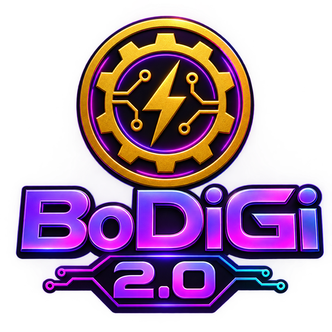

<p align="center">
  
</p>

<p align="center"><strong>AI-powered application factory.</strong> One prompt in — a full marketplace-ready app comes out.</p>

BoDiGi 2.0™️ uses a team of specialized AI agents to take a single plain-English description and produce a complete, deployable application: frontend, backend, database schema, API routes, tests, compliance docs, marketing kit, launch guide, and deployment configuration.

## How It Works

1. **Describe your app** — plain English, or let Plan Mode's interview agent sharpen the idea first
2. **The agent team builds it** — ten named specialists work in sequence
3. **Preview goes live** — your app is deployed; share the URL
4. **Keep building** — AI modifications, engagement loops, rollback, docs, Day-2 fixes
5. **Export when ready** — download the full source code or push to GitHub

## The Agent Team

| Agent | Name | Role |
|-------|------|------|
| Project Manager | **Nova** | Breaks the idea into specs and tasks — every build starts with her |
| Architect | **Atlas** | System architecture, tech stack, data models |
| Database | **Vault** | Schema, migrations, RLS — keeps everything safe |
| Backend | **Forge** | API routes, business logic, auth |
| Frontend | **Prism** | UI components, pages, styling — everything you see |
| Testing | **Scout** | Test plans and execution — finds trouble before it arrives |
| Compliance | **Aegis** | Security, GDPR, accessibility — the shield |
| DevOps | **Pilot** | Deployment config — gets it off the ground |
| Docs | **Scribe** | Documentation, investor docs, marketing kit |
| Healing | **Mend** | Day-2 fixes — detects issues, opens PRs |

Plus standalone agents: the Plan Mode interviewer, the Setup Agent (guided API keys), support chat, the loop-wiring agent, and the **Brand Agent** — on-demand logo, palette, and voice for every app, because a business builder that ships no brand ships anonymous software. The kit rides along in the ZIP export (`brand/logo.png`, `palette.json`, `BRAND.md`) and shows on the public showcase.

## Feature Set

**Pre-build**
- Plan Mode — AI interview turns a rough idea into a build brief
- Required-APIs detection, provider pricing advisor, agentic capability detection

**Build**
- Full pipeline with fallback generators, project rename, live progress

**Post-build**
- Build Memory — the pipeline learns generalized rules from every build, every Modify Pass, and every failure, then injects them into future generations (`build_lessons` table + `build-memory.ts`). Each app starts smarter than the last
- AI modifications (click-to-edit via the modify route)
- Version history + one-click rollback
- GitHub export
- Day-2 Agent — post-launch issue diagnosis and fix PRs
- Engagement Loop Builder — action→reward loops wired into your app (max 8)

**Ad Studio**
- AI avatar video ads for your app (HeyGen v3, Avatar V engine, SRT captions, 16:9 + 9:16)
- Pay-per-video checkout — $4.99 (30s) / $12.99 (1–2 min) via Stripe, render fires only after payment clears
- 25% of each sale auto-carves into the AI reserve ledger; admins render free

**Deployment**
- Zero-Key Sandbox — apps work on first deploy with auto-injected test-mode keys; guided handoff to real keys
- Domain Assistant + custom domain setup

**Marketplace**
- Showcase gallery + per-app investor pages (public, ISR)
- Templates gallery — fork any public template
- Template marketplace — sell your builds ($0–$5000, Stripe one-time checkout, 80/20 split)

**Docs & Growth**
- Docs shelf (README, investor doc, marketing kit, launch guide)
- LAUNCH_GUIDE.md — channel strategy + "Built with BoDiGi" vote loop
- Support chat (users) + admin support inbox with email notifications

**Admin**
- User tier/role management
- Security audit panel — live scored scan (auth probes, bundle secrets, RLS, headers, rate limits)
- Accounting panel — revenue vs AI spend vs margin, per-agent cost attribution, cost outliers, budget runway

**Security**
- 22+ RLS policies, rate limiting on all sensitive routes, security headers (HSTS, nosniff, frame protection), auth guards, IDOR protection

## Pricing Tiers

| | Free | Starter $19/mo | Pro $49/mo | Enterprise $199/mo |
|---|---|---|---|---|
| Builds | 1/mo | 5/mo | Unlimited | Unlimited |
| Plan Mode, API list, Domain Assistant | ✓ | ✓ | ✓ | ✓ |
| AI modifications | 3 trial uses | ✓ | ✓ | ✓ |
| Per-app AI caps | 3 lifetime | 15/mo | 50/mo | Unlimited |
| Rollback, GitHub export, Day-2 PRs | — | ✓ | ✓ | ✓ |
| Docs downloads | Watermarked | Clean | Clean | Clean |
| Template marketplace | — | — | ✓ | ✓ |
| Engagement loops | Configure only | Wire | Wire | Wire |

## Sustainability

Every AI call logs tokens + estimated cost. Every Stripe payment automatically carves a reserve (default 25%, `AI_RESERVE_PERCENT`) into a revenue ledger *before* it counts as profit — that reserve is next month's AI budget. Per-app AI caps keep any single user from outspending their tier. The admin Accounting panel shows the whole picture: what's collected, what's reserved, what's profit, and which agent spent what and why.

## Tech Stack

- **Framework:** Next.js 16 (App Router, Turbopack)
- **Language:** TypeScript
- **Database:** Supabase (PostgreSQL, Row Level Security)
- **Auth:** Supabase Auth (email/password, Google, GitHub)
- **AI:** OpenRouter (default `openai/gpt-4o-mini`, `AI_MODEL` global override, `AI_MODEL_<ROLE>` per-role overrides for codegen) with Telnyx fallback — all calls through the `ai-client.ts` abstraction
- **Payments:** Stripe (subscriptions + one-time template purchases)
- **Email:** Resend
- **Styling:** Tailwind CSS · **Icons:** Lucide React
- **Deployment:** Vercel

## Getting Started

### Prerequisites

- Node.js 18+
- An [OpenRouter](https://openrouter.ai) API key (for AI inference)
- A [Supabase](https://supabase.com) project (database + auth)
- Stripe + Resend keys for payments and email

### Environment Variables

```bash
# Supabase
NEXT_PUBLIC_SUPABASE_URL=https://your-project.supabase.co
NEXT_PUBLIC_SUPABASE_ANON_KEY=your-publishable-key
SUPABASE_SERVICE_ROLE_KEY=your-secret-key

# AI
OPENROUTER_API_KEY=your-openrouter-key
AI_MODEL=openai/gpt-4o-mini            # optional override
TELNYX_API_KEY=your-telnyx-key         # optional fallback provider

# Stripe
STRIPE_SECRET_KEY=sk_...
NEXT_PUBLIC_STRIPE_PUBLISHABLE_KEY=pk_...
STRIPE_WEBHOOK_SECRET=whsec_...

# Email
RESEND_API_KEY=re_...
RESEND_EMAIL_DOMAIN=yourdomain.com
EMAIL_FROM=support@yourdomain.com

# Sustainability knobs (optional)
AI_RESERVE_PERCENT=25                  # reserve carved off each payment
AI_MONTHLY_BUDGET_CENTS=5000           # AI budget for runway calc

# Letta (optional, agent orchestration)
LETTA_API_KEY=your-letta-key
```

### Database Setup

Run the SQL migrations in order in your Supabase SQL Editor — `supabase/migrations/001` through `017` (schema, profiles, tiers, showcase, engagement loops, templates, purchases, usage ledger, revenue ledger, reverse trial, API key constraints, build memory).

### Development

```bash
npm install
npm run dev
```

Open [http://localhost:3000](http://localhost:3000).

## Pages

| Route | Description |
|-------|-------------|
| `/` | Landing + project creation |
| `/dashboard` | Your projects (protected) |
| `/dashboard/[projectId]` | Project detail, pipeline progress, agent activity |
| `/preview/[projectId]` | Live preview, publish toggle, loop builder, docs |
| `/showcase` + `/showcase/[slug]` | Public gallery + investor pages |
| `/templates` | Template gallery — fork or buy |
| `/admin` | Admin panel — users, security audit, accounting |
| `/pricing` | Subscription plans |
| `/setup` | API key setup guide |

## A Note on Expectations

BoDiGi 2.0 gives founders a head start — a working app, the documents, and the launch tools. It does not guarantee business success, revenue, or users. Building a real business takes substantial ongoing work on the founder's end: marketing, sales, support, and persistence. See the [Terms of Service](src/app/terms/page.tsx) for the full disclaimer.

## License

Proprietary. All rights reserved.

---

Built with [Letta](https://letta.com) — the AI agent framework.

<!-- deploy-canary: efd2689+1 2026-09-26T08:20Z -->
